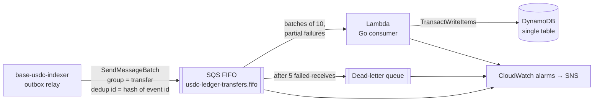

# USDC Deposit Ledger


The crediting half of an on-chain deposit system, built on **AWS SQS, Lambda and DynamoDB**.

[base-usdc-indexer](https://github.com/BrianLiu0531/base-usdc-indexer) detects USDC transfers on Base and emits `transfer.confirmed` (and, after a reorg, `transfer.reverted`) events through a transactional outbox. This service consumes those events and keeps a ledger of what each account has been credited. **Every event is applied exactly once**, however many times SQS delivers it, including when two copies of a message are processed at the same moment.

**Stack:** Go · AWS Lambda (arm64, `provided.al2023`) · SQS FIFO + DLQ · DynamoDB · CloudWatch · Terraform · GitHub Actions with OIDC



## Why the design looks like this

| Problem | Solution |
|---|---|
| **At-least-once delivery.** SQS, the relay and Lambda retries can all deliver an event twice. | Each event is applied in **one DynamoDB transaction** that also writes an `EVENT#<eventId>` marker with `attribute_not_exists(PK)`. A second delivery fails that condition and changes nothing. No read-then-write check exists that two concurrent invocations could both pass. |
| **Deduplication windows.** SQS FIFO deduplicates for only 5 minutes. | The SQS dedup ID is a hash of the deterministic event ID, so quick resends are dropped by SQS. Anything later hits the DynamoDB marker. Markers expire after 30 days via TTL, longer than SQS can hold a message. |
| **Ordering.** A revert must not overtake the credit it undoes. | The message group is the transfer `(chain, tx, logIndex)`, so its events stay in order while different transfers run in parallel. Balances change only by addition, so even out-of-order events converge on the same total, and the tests check this. |
| **Partial batch failures.** One bad message shouldn't make nine good ones retry. | `ReportBatchItemFailures` retries only failed messages. Within a FIFO group, messages after a failure are also failed so their order survives the retry. |
| **Poison messages.** | A message that can never be applied fails until `maxReceiveCount` (5) moves it to the DLQ, which pages through CloudWatch → SNS. |
| **Credentials.** | GitHub Actions assumes an IAM role through OIDC, limited to this repo's `main` branch and to resources named `usdc-ledger-*`. The indexer gets a policy allowing only `sqs:SendMessage` on one queue. No long-lived keys anywhere. |

### DynamoDB single-table layout

| PK | SK | Item |
|---|---|---|
| `EVENT#<eventId>` | `EVENT` | idempotency marker (`expiresAt` TTL) |
| `ACCT#<address>` | `BALANCE` | `netCredited`, `entries`, `updatedAt` |
| `ACCT#<address>` | `ENTRY#<block>#<logIndex>#<C\|R>#<blockHash>` | one ledger line: delta, tx hash, counterparty, event ID |

A deposit credits the receiver and a withdrawal debits the sender. A transfer between two watched accounts updates both in the same transaction. A self-transfer is recorded with a net delta of zero.

## Verified end to end

**On AWS (ap-southeast-2):** the stack was deployed from GitHub Actions through OIDC. The indexer then published live Base Sepolia transfers to the real SQS queue, and the Lambda function credited them to DynamoDB. The ledger matched the indexer's finalized totals exactly: 32 transfers, net `-4000` base units, and an empty DLQ.

That run also surfaced a problem the local stand-ins never showed. Parallel Lambda invocations updating the same account's balance item caused **`TransactionConflict`** cancellations. No event was lost or double-applied: the failed messages were retried after the visibility timeout. But crediting was delayed by 3 minutes, so the ledger now retries conflicts immediately, with jittered backoff. A whole-transaction retry can never apply twice.

**Locally**, with ElasticMQ standing in for SQS and DynamoDB Local for DynamoDB:

- **28 finalized transfers** were indexed, published, consumed and credited. The DynamoDB ledger total (`-10000` base units over 28 entries) matched the indexer's own finalized net flow exactly.
- **Every outbox event was then sent again.** The ledger did not change: SQS deduplication dropped the resends, and the conditional write covers resends after the window.

## Tests

```bash
docker compose up -d   # DynamoDB Local + ElasticMQ
go test ./...
```

- **Ledger** (against DynamoDB Local):
  - redelivered events are credited once
  - **20 concurrent workers given the same event credit it exactly once**
  - 20 different events for one account at once all succeed (conflicts are retried)
  - conflicts are retried and then given up on, and a duplicate is detected whichever item fails its condition
  - reverts apply in any order, including re-inclusion in a new block
  - withdrawals, internal transfers and self-transfers
  - transfers between unwatched addresses are ignored
  - amounts beyond DynamoDB's precision are rejected
- **Handler:**
  - only failed messages are reported
  - FIFO order is kept within a group after a failure
- **End to end** (ElasticMQ + DynamoDB Local): a duplicate event is credited once, a revert is applied, and a malformed message lands in the dead-letter queue after the configured receive count.
- **Event parsing:** validation and normalisation.

CI runs everything with the race detector, builds the Lambda package, and runs `terraform fmt` and `validate` on both stacks.

## Run the whole pipeline locally

```bash
docker compose up -d                      # ElasticMQ (queues preconfigured) + DynamoDB Local
docker compose --profile consumer up -d   # the consumer, polling the local queue
```

Then, from a checkout of [base-usdc-indexer](https://github.com/BrianLiu0531/base-usdc-indexer) with its database running, start the indexer pointed at the local queue:

```bash
AWS_REGION=ap-southeast-2 AWS_ACCESS_KEY_ID=local AWS_SECRET_ACCESS_KEY=local \
AWS_ENDPOINT_URL_SQS=http://localhost:9324 \
OUTBOX_SQS_QUEUE_URL=http://localhost:9324/000000000000/usdc-transfers.fifo \
go run ./cmd/indexer
```

`cmd/local` runs the same handler as the Lambda function through a small poller that mimics the Lambda event source mapping: receive, invoke, then delete only the messages that succeeded.

## Deploy to AWS

1. **Bootstrap (once, with admin credentials):**
   ```bash
   cd terraform/bootstrap
   terraform init && terraform apply -var budget_email=you@example.com
   ```
   This creates the state bucket, the GitHub OIDC provider, the deploy role and a US$5 monthly budget alert.
2. **GitHub settings** (Settings → Secrets and variables → Actions):
   - **Secrets:** `AWS_DEPLOY_ROLE_ARN` and `TF_STATE_BUCKET`, from the bootstrap outputs. They are secrets because they contain the account ID and workflow logs on a public repo are public.
   - **Variables:** `WATCH_ADDRESSES` (JSON list, e.g. `["0xabc…"]`) and optionally `ALARM_EMAIL`.
3. **Run the Deploy workflow** (Actions → Deploy → Run workflow). It tests, builds the arm64 package and runs `terraform apply`. The outputs include the queue URL and the publisher policy.
4. **Point the indexer at the queue:** set `OUTBOX_SQS_QUEUE_URL` to the `queue_url` output, and give whatever runs the indexer the `publisher_policy_arn` policy.

**Cost:** at portfolio traffic everything stays within the AWS free tier (Lambda, SQS, DynamoDB on-demand). The CloudWatch alarms are within the free tier's 10 alarms, and the state bucket costs cents.

## Layout

```
cmd/consumer       Lambda entry point
cmd/local          same handler polling SQS directly (docker compose, debugging)
internal/event     event schema and validation
internal/ledger    idempotent DynamoDB ledger (single table, TransactWriteItems)
internal/handler   SQS batch handling, partial failures, FIFO ordering
internal/poller    receive/handle/delete loop used by cmd/local
terraform/bootstrap  state bucket, GitHub OIDC deploy role, budget
terraform/app        SQS FIFO + DLQ, Lambda, DynamoDB, IAM, CloudWatch alarms
```
